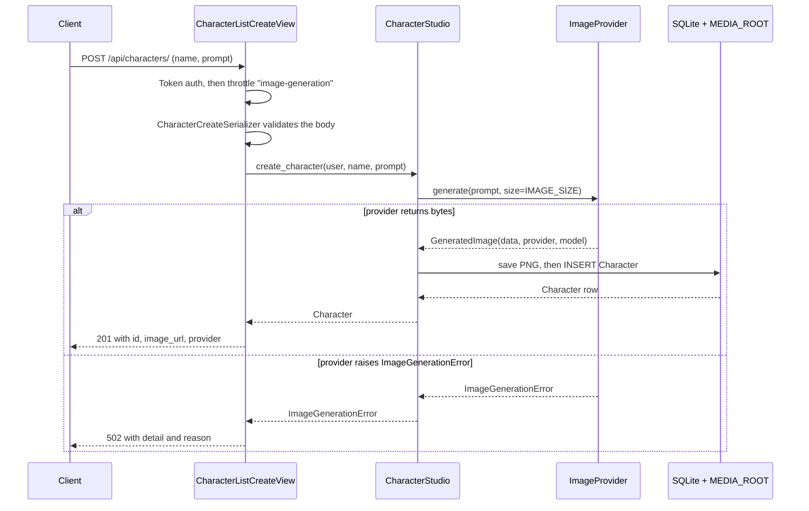

# persona-portrait-api

A small Django/DRF service that turns a sentence about a character into a stored
portrait: POST a name and a prompt, it renders an image, writes it under
`MEDIA_ROOT`, and returns a row you can list, search, fetch and delete. Generation
sits behind an `ImageProvider` interface with two implementations, OpenAI and a
deterministic offline renderer. The offline one is the default, so a fresh clone,
the container and `manage.py test` need no API key and no network.

<p>
  
  
</p>

Those two are real output of the offline provider for the prompts in the examples
below: abstract placeholders, not AI portraits. Every row records which provider
and model produced it, so swapping in OpenAI later leaves the data traceable.

## Run it

Docker Compose is the supported path. It needs a `DJANGO_SECRET_KEY` and refuses
to start without one.

```bash
cp .env.example .env
# set DJANGO_SECRET_KEY= in .env to the output of:
python3 -c "import secrets; print(secrets.token_urlsafe(50))"
docker compose up --build -d                        # http://localhost:7171
docker compose exec api python manage.py createsuperuser
```

The container migrates on start, serves through gunicorn as uid 10001, and keeps
the SQLite file and the rendered PNGs on the `portrait-data` volume.
`curl localhost:7171/api/health/` answers once it is up:

```json
{"status": "ok", "database": "ok", "image_provider": "local", "providers_available": ["local", "openai"]}
```

Without Docker, use Python 3.13 (see `.python-version`) in a virtualenv:

```bash
python -m venv .venv && . .venv/bin/activate
pip install -r requirements-dev.txt
python manage.py migrate
python manage.py createsuperuser
python manage.py runserver 7171
```

## One request, one portrait

```bash
TOKEN=$(curl -s -X POST http://127.0.0.1:7171/api/auth/token/ \
  -H 'Content-Type: application/json' \
  -d '{"username":"ada","password":"portrait-pass-123"}' \
  | python3 -c 'import sys,json;print(json.load(sys.stdin)["token"])')

curl -s -X POST http://127.0.0.1:7171/api/characters/ \
  -H "Authorization: Token $TOKEN" -H 'Content-Type: application/json' \
  -d '{"name":"Captain Vale","prompt":"a weathered sea captain with a silver beard"}'
```

`201 Created`:

```json
{"id":1,"name":"Captain Vale","prompt":"a weathered sea captain with a silver beard",
 "image_url":"http://127.0.0.1:7171/media/character_images/captain-vale-b203d5fbb140.png",
 "provider":"local","image_model":"local-identicon-v1","owner":"ada",
 "created_at":"2026-11-08T12:56:16.288772Z"}
```

`GET` that `image_url` and you get a 1024x1024 PNG of about 4.7 KB. The other
answers you will meet, captured from the same running container:

| Request | Status | Body |
|---|---|---|
| `GET /api/characters/` with no token | `401` | `{"detail":"Authentication credentials were not provided."}` |
| `POST /api/characters/` with no `prompt` | `400` | `{"prompt":["This field is required."]}` |
| `GET /api/characters/?search=storm` | `200` | `{"count":1,"next":null,"previous":null,"results":[{"id":2,"name":"Mirela Thorn",...}]}` |
| `DELETE /api/characters/2/` | `204` | empty; the PNG is removed too |
| `GET /api/characters/2/` afterwards | `404` | `{"detail":"No Character matches the given query."}` |

## No key, no problem

`IMAGE_PROVIDER` picks the backend. With no `OPENAI_API_KEY` it resolves to
`local`, which derives a symmetric colour field from the SHA-256 of the prompt:
same prompt in, byte-identical PNG out, which is what the tests assert against.
Set `OPENAI_API_KEY` and the default flips to `openai`: `client.images.generate`
with `OPENAI_IMAGE_MODEL` (default `gpt-image-1`), base64 decoded. The `openai`
package is imported lazily, so nothing else depends on it being installed.
A third backend is a subclass plus `register("replicate", ReplicateProvider)`.

## What happens between POST and 201



The view never imports a provider or touches the filesystem: it validates, calls
`CharacterStudio`, and maps one exception type to one status code. Missing key,
timeout and undecodable payload all arrive as `ImageGenerationError`, and none of
them leave a half-written row behind. If the INSERT itself fails, the PNG that was
already written is deleted before the error propagates.

## Endpoints

| Method | Path | Notes |
|---|---|---|
| `POST` | `/api/auth/token/` | Username + password in, DRF token out. Public. |
| `GET` | `/api/health/` | Status, DB round-trip, active provider. Public. |
| `POST` | `/api/characters/` | Generate. Throttled by `IMAGE_GENERATION_RATE`. |
| `GET` | `/api/characters/` | Own rows, newest first. `?search=`, `?page=`, `?page_size=` (max 100). |
| `GET` | `/api/characters/{id}/` | Own rows only; anyone else's is a 404, not a 403. |
| `DELETE` | `/api/characters/{id}/` | Deletes the row and the rendered file. |
| `GET` | `/media/<path>` | The PNGs, when `DJANGO_SERVE_MEDIA` is on. Public by URL. |

Scoping to `request.user` happens in one place (`OwnedCharactersMixin`) and uses
`select_related("user")`, so listing ten characters costs the same two queries as
listing one. A test asserts exactly that.

## Settings

Everything lives in `.env` (see `.env.example`); real environment variables win.
Nothing is hard-coded except a development `SECRET_KEY` the app refuses to use once
`DJANGO_DEBUG` is off: it raises on startup instead. Knobs: `IMAGE_PROVIDER`,
`IMAGE_SIZE`, `OPENAI_IMAGE_MODEL`, `OPENAI_TIMEOUT_SECONDS`, `CHARACTER_PAGE_SIZE`,
`IMAGE_GENERATION_RATE`, `DJANGO_DB_PATH`, `DJANGO_MEDIA_ROOT`, `DJANGO_ALLOWED_HOSTS`,
`DJANGO_SERVE_MEDIA`.

`DJANGO_SERVE_MEDIA` defaults to the value of `DJANGO_DEBUG`. Compose turns it on,
because gunicorn is the only server in that stack and the `image_url` values would
otherwise point at nothing. Behind nginx, S3 or a CDN, leave it off.

## Tests and lint

```bash
python manage.py test                      # 80 tests
ruff check . && ruff format --check .
```

The suite covers provider determinism, the OpenAI response mapping (stub client, no
network, no key), storage and orphan-file cleanup, auth, validation, ownership
scoping, paging, search, throttling, media serving and the 502 path.

## Known gaps

- SQLite only; `DATABASES` is the one place to change for Postgres, untested.
- Generation is synchronous. A queue returning `202` plus a job id belongs at the
  `CharacterStudio` seam.
- `MEDIA_ROOT` is local disk: no S3, no CDN. Portrait URLs are unguessable but not
  access-controlled.
- With `DJANGO_DEBUG` off the admin works but is unstyled: nothing collects or
  serves its static files.
- Tokens never expire, and users come from `manage.py` or the admin; there is no
  registration endpoint.

## License

MIT, see [LICENSE](LICENSE).
